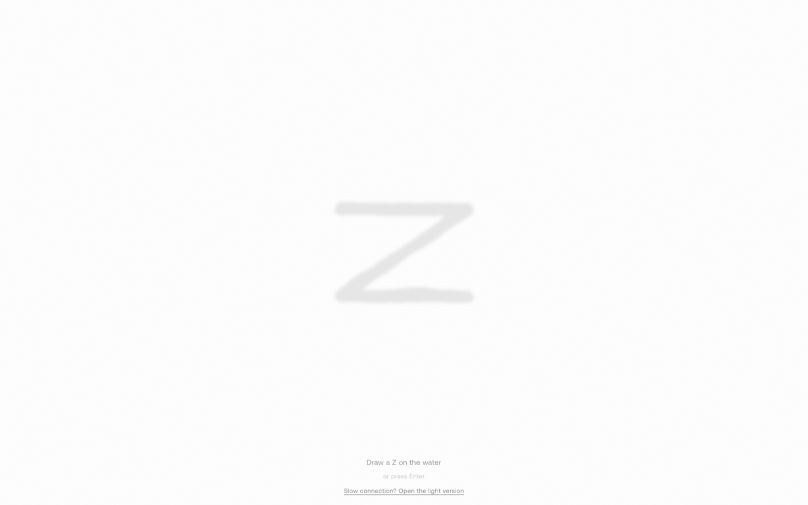
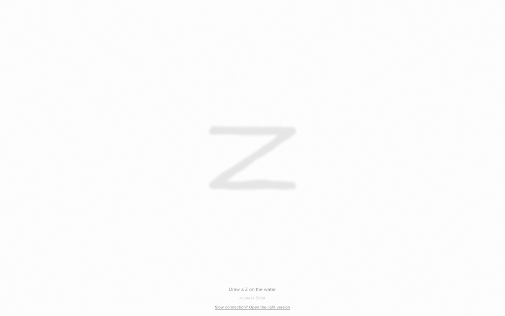
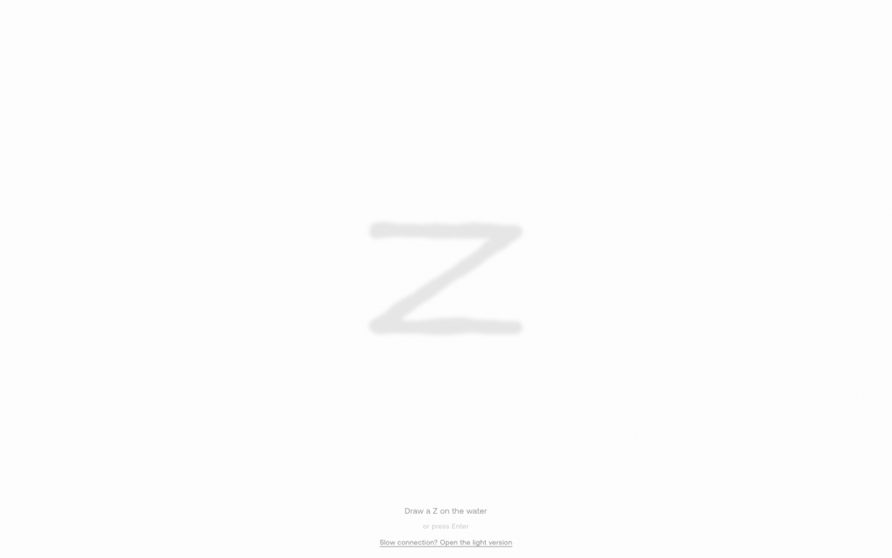
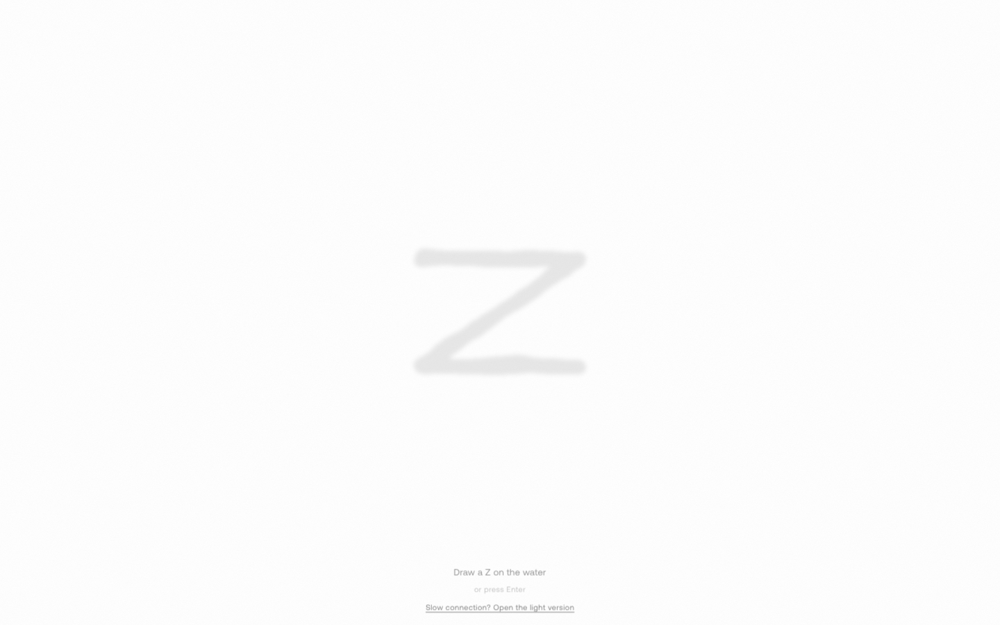
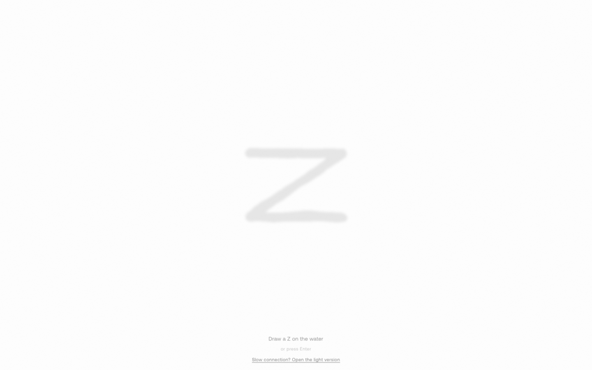
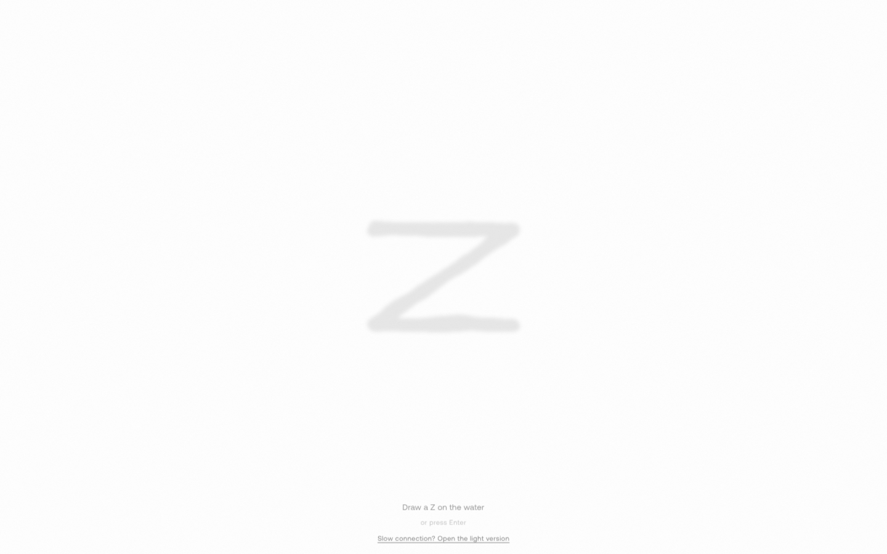
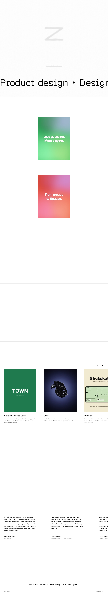
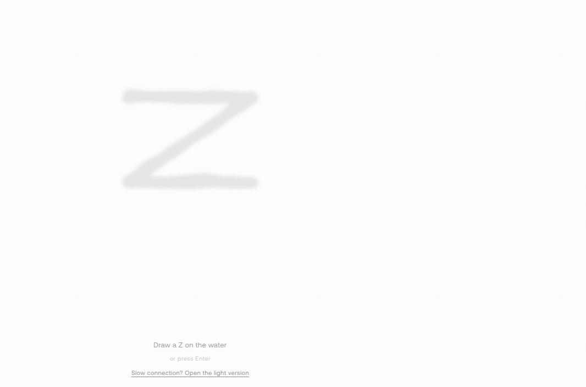

# jithinrp — Visual Guide

> Master visual reference. Study every screenshot carefully before implementing any UI.
> Match colors, layout, typography, spacing, and motion states exactly.

**Motion Stack:** **GSAP**, **ScrollTrigger**, **Three.js**, **Web Animations API (2 active)**

**WebGL/3D:** Detected (3 canvas elements) — replicate with Three.js or CSS 3D transforms

## Scroll Journey

The page has cinematic scroll animations. Each screenshot below shows the exact visual state at that scroll depth.
**Replicate these transitions precisely** — the design changes dramatically as you scroll.

### Hero — Above the fold

*Scroll position: 0px of 7909px total*

### 17% scroll depth

*Scroll position: 1192px of 7909px total*

### 33% scroll depth

*Scroll position: 2313px of 7909px total*

### 50% scroll depth

*Scroll position: 3505px of 7909px total*

### 67% scroll depth

*Scroll position: 4696px of 7909px total*

### 83% scroll depth

*Scroll position: 5817px of 7909px total*

### Footer — End of page

*Scroll position: 7009px of 7909px total*

## Full Page Screenshots

### Jithin RP — Senior Product Designer

*URL: `https://jithinrp.com/`*

### Memory — Jithin RP

*URL: `https://jithinrp.com/memory/`*

### Slot Booking — Turning Slot Selection into a Confident Decision | Jithin RP

*URL: `https://jithinrp.com/slot-booking`*

### Squads — Community Experience | Jithin RP

*URL: `https://jithinrp.com/squads`*

## Section Screenshots

Clipped sections showing individual components in context.

### Section 1 — `section`

*1440×731px*

### Section 1 — `section`

*1066×704px*

### Section 1 — `section`

*1440×400px*

### Section 2 — `section`

*1440×804px*

### Section 1 — `section`

*1440×400px*

### Section 2 — `section`

*1440×804px*

